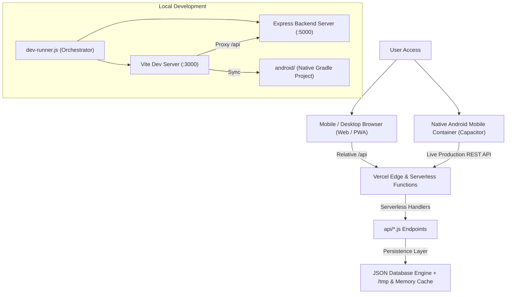

# ⚡ LIMO — Engineering Project Hub

<div align="center">

# 🚀 ENGINEERING PROJECT HUB
### *Build • Innovate • Simulate • Engineer*

A next-generation platform for showcasing, exploring, and managing cutting-edge engineering projects, prototypes, quantum simulations, and multidisciplinary research.

[](https://temporary-express-tuba-avfyt8a.vercel.app)
[](https://github.com/likiliki27070-rgb/Engineering-project-hub-)
[](https://capacitorjs.com/)
[](https://web.dev/progressive-web-apps/)
[](https://react.dev/)
[](https://www.typescriptlang.org/)
[](LICENSE)

<br/>

🌐 **[Experience Live Web App](https://temporary-express-tuba-avfyt8a.vercel.app)** • 📱 **[Mobile App Guide](#-mobile-application-android--pwa)** • 🛠️ **[Local Setup](#-local-installation--setup-guide)** • 📖 **[API Reference](#-api-documentation)**

</div>

---

## 📑 Table of Contents

1. [🌟 Project Overview](#-project-overview)
2. [✨ Key Features (A to Z)](#-key-features-a-to-z)
3. [🏛️ Architecture & Tech Stack](#️-architecture--tech-stack)
4. [📱 Mobile Application (Android & PWA)](#-mobile-application-android--pwa)
5. [🚗 Featured Engineering Project: LIMO](#-featured-engineering-project-limo)
6. [🌐 Live Deployment Links](#-live-deployment-links)
7. [🛠️ Local Installation & Setup Guide](#️-local-installation--setup-guide)
8. [📡 API Documentation](#-api-documentation)
9. [📁 Repository Structure](#-repository-structure)
10. [⚙️ Deployment Guide (Vercel & Mobile CI/CD)](#️-deployment-guide-vercel--mobile-cicd)
11. [👥 Contributors & Creators](#-contributors--creators)
12. [📄 License](#-license)

---

## 🌟 Project Overview

**Engineering Project Hub (LIMO)** is an interactive, full-stack platform engineered to centralize academic, industrial, and open-source engineering achievements. It addresses the fragmentation of engineering portfolios by providing an immersive, 3D-accelerated environment where developers, researchers, students, and institutions can discover, analyze, and publish groundbreaking innovations across 20+ specialized disciplines.

From quantum computing and autonomous robotics to renewable energy grids, embedded IoT systems, and zero-knowledge blockchains, the Engineering Project Hub provides rich telemetry, downloadable technical bundles, algorithmic formulations, collaborative discussion boards, and **native cross-platform mobile access**.

---

## ✨ Key Features (A to Z)

- **🎨 3D Interactive Particle Canvas**: Dynamic HTML5 canvas background rendering real-time particle physics, constellation networks, and cursor-reactive gravitational wave simulations.
- **📊 Admin Control Center**: Comprehensive dashboard allowing platform moderators to monitor metrics, approve pending project submissions, manage creator rosters, broadcast system alerts, and inspect audit activity logs.
- **📱 Android Native Application**: Complete native Android project container powered by Capacitor 8, featuring adaptive launcher icons, dark status bar integration, safe-area padding, and hardware back-button navigation.
- **🏷️ 20+ Engineering Disciplines**: Multi-domain classification spanning AI/ML, Quantum Computing, Robotics, Cyber-Physical Systems, Electrical, Mechanical, Civil, eBPF Kernel, Blockchain, and Renewable Energy.
- **🔎 Advanced Search & Multi-Criteria Filtering**: Instantaneous debounced filtering by full-text query, discipline, technology stack, difficulty tier (Beginner, Intermediate, Advanced), and sort order (Latest, Most Viewed, Most Liked, A-Z).
- **💡 Algorithmic Formulation Deep-Dives**: Detailed theoretical breakdowns of mathematical frameworks (e.g., QUBO matrix formulations, QAOA Hamiltonian circuits, eBPF kernel hooks, zk-SNARK constraints).
- **🌗 Custom Theme Engine**: Live theme drawer with 6 aesthetic color schemes (Deep Space Dark, Clean Light, Cyberpunk Neon, Emerald Matrix, Sapphire Frost, Sunset Amber) with persistent preferences.
- **📦 Downloadable Engineering Bundles**: Integrated modal for downloading source repositories, CAD mechanical models, simulation datasets, technical whitepapers, and firmware binaries.
- **⚡ Dual-Mode Full-Stack Architecture**: Runs concurrently in development via custom orchestrator (`dev-runner.js`) and compiles into high-performance serverless edge functions on Vercel.
- **🔐 Multi-Role Authentication**: JWT-compatible credential and demo session workflows supporting Administrator, Researcher, Student, and Guest privileges.
- **💬 Peer Discussion & Engagement**: Interactive comment threads, real-time upvoting counters, view analytics, and social share modals with one-click clipboard copying.
- **📲 Progressive Web App (PWA)**: Installable directly from mobile and desktop browsers (Chrome, Edge, Safari) via `manifest.json` and offline-capable Service Worker (`sw.js`).
- **📱 Responsive Glassmorphic Interface**: Fully mobile-responsive layout crafted with clean vanilla CSS tokens, backdrop blurs, glow accents, and fluid typography (Outfit, Inter, and JetBrains Mono).

---

## 🏛️ Architecture & Tech Stack



### Core Technologies

| Layer | Technologies |
| :--- | :--- |
| **Mobile Native Container** | Capacitor 8 (`@capacitor/core`, `@capacitor/android`, `@capacitor/app`, `@capacitor/status-bar`, `@capacitor/splash-screen`) |
| **PWA Engine** | Web App Manifest (`manifest.json`), Service Worker (`sw.js`), Cache API |
| **Frontend Framework** | React 18, TypeScript, Vite 5 |
| **Styling & Aesthetics** | Pure Modern CSS, Glassmorphism, CSS Custom Properties, Safe Area Insets, Canvas Physics |
| **Typography** | Outfit (Headings), Inter (Body UI), JetBrains Mono (Code/Math) |
| **Icons & Visuals** | Lucide React, SVG Vector System, Canvas Confetti |
| **Backend Runtime** | Node.js, Express 4, ES Modules (`import/export`) |
| **Database & Cache** | File-backed JSON DB with automated seed generator and fail-safe serverless in-memory cache |
| **Deployment Engine** | Vercel Edge CDN, Vercel Serverless Functions (`@vercel/node`) |

---

## 📱 Mobile Application (Android & PWA)

The mobile transformation preserves the existing website and backend completely while adding native mobile distribution and browser installability:

### 1. Capacitor Native Android Architecture
- **Package Identifier**: `com.limohub.engineering`
- **Application Name**: `LIMO Hub`
- **Native Project Location**: [`android/`](android/)
- **Native Integrations**:
  - **Hardware / Gesture Back Button**: Intercepted in `src/App.tsx` via `@capacitor/app`. When on subpages, it navigates back in history; when on the Home page, it exits the application gracefully.
  - **Status Bar**: Styled dark (`#0a0e17`) to seamlessly blend with the futuristic UI.
  - **Splash Screen**: Centered launch screen with auto-hide upon web initialization.
  - **Dynamic API Resolution**: Automatically switches from relative `/api` (used on the web) to the live production server (`https://temporary-express-tuba-avfyt8a.vercel.app/api`) when running inside the native APK.

### 2. Mobile Development Commands

| Command | Action |
| :--- | :--- |
| `pnpm run mobile:sync` | Compiles the Vite frontend and synchronizes web assets & plugins to `android/` |
| `pnpm run mobile:open` | Opens the native Android project in Android Studio |
| `pnpm run mobile:build:apk` | Assembles a Debug APK locally via Gradle wrapper (`gradlew assembleDebug`) |
| `pnpm run mobile:build:aab` | Builds an Android App Bundle (`gradlew bundleRelease`) for Google Play |

### 3. How to Build the APK Locally with Android Studio

1. **Install Android Studio** ([Download Android Studio](https://developer.android.com/studio)).
2. Synchronize your latest web build into the Android project:
   ```bash
   pnpm run mobile:sync
   ```
3. Open the project in Android Studio:
   ```bash
   pnpm run mobile:open
   ```
   *(Or launch Android Studio and select the `android/` folder inside this repository).*
4. In Android Studio:
   - Wait for Gradle sync to complete.
   - Click **Build > Build Bundle(s) / APK(s) > Build APK(s)**.
   - The generated APK will be at: `android/app/build/outputs/apk/debug/app-debug.apk`.

### 4. Automated Cloud Build via GitHub Actions

A continuous integration workflow (`.github/workflows/ci-mobile-build.yml`) is included in the repository. Whenever code is pushed to `main`:
1. It validates the web build.
2. It sets up Java 21 & Android SDK.
3. It compiles `app-debug.apk` and uploads it as a downloadable artifact under the **Actions** tab on GitHub.

### 5. Progressive Web App (PWA) Installation

Users can also install the application directly from any mobile or desktop browser without an app store:
- **Android (Chrome)**: Tap the menu (three dots) > Tap **"Install app"** or **"Add to Home screen"**.
- **iOS (Safari)**: Tap the Share button > Scroll down and tap **"Add to Home Screen"**.

---

## 🚗 Featured Engineering Project: LIMO

One of the cornerstone flagship engineering projects hosted on the platform is **LIMO — Quantum Traffic Optimization**:

- **Core Problem**: Urban traffic gridlocks generate billions of dollars in economic loss and excessive emissions. Classical Dijkstra and heuristic pathfinding fail when thousands of vehicles compete for the same road segment dynamically.
- **Quantum Formulation**: Formulated as a **Quadratic Unconstrained Binary Optimization (QUBO)** problem mapped onto the **Quantum Approximate Optimization Algorithm (QAOA)**:
  $$\min_{x \in \{0, 1\}^n} x^T Q x + c^T x$$
  where $Q$ penalizes route collisions and latency bottlenecks.
- **Hardware Target**: Simulated on D-Wave Quantum Annealers and IBM Qiskit gate-based quantum circuits.
- **Demonstrated Results**: Up to **38.4% reduction in peak-hour arterial delay** and **29.1% reduction in idle fuel consumption**.

---

## 🌐 Live Deployment Links

| Environment | URL | Status |
| :--- | :--- | :--- |
| **Production Web App** | [https://temporary-express-tuba-avfyt8a.vercel.app](https://temporary-express-tuba-avfyt8a.vercel.app) | 🟢 Live & Operational |
| **Claim Deployment** | [Claim to Your Vercel Dashboard](https://vercel.com/claim-deployment?code=3e4058ac-db40-43f9-af60-84377fe59017) | 🔗 Ready to Claim |
| **GitHub Repository** | [likiliki27070-rgb/Engineering-project-hub-](https://github.com/likiliki27070-rgb/Engineering-project-hub-) | 🟢 Main Branch Synced |
| **Health Check API** | [/api/health](https://temporary-express-tuba-avfyt8a.vercel.app/api/health) | 🟢 HTTP 200 OK |

---

## 🛠️ Local Installation & Setup Guide

Follow these steps to run the complete Engineering Project Hub full-stack platform on your local machine:

### Prerequisites

Ensure you have the following installed on your operating system:
- **Node.js**: v18.0.0 or higher ([Download Node.js](https://nodejs.org/))
- **pnpm** (recommended) or **npm**:
  ```bash
  npm install -g pnpm
  ```
- **Git**: ([Download Git](https://git-scm.com/))

---

### Step 1: Clone the Repository

```bash
git clone git@github.com:likiliki27070-rgb/Engineering-project-hub-.git
cd Engineering-project-hub-
```
*(Or clone via HTTPS if you haven't configured SSH keys:)*
```bash
git clone https://github.com/likiliki27070-rgb/Engineering-project-hub-.git
cd Engineering-project-hub-
```

---

### Step 2: Install Dependencies

Install all root dependencies (frontend, backend, mobile tools, and build scripts):

```bash
pnpm install
```
*(Or with npm:)*
```bash
npm install
```

---

### Step 3: Run the Full-Stack Application

The repository includes a concurrent development orchestrator (`dev-runner.js`) that launches both the Express backend API and the Vite frontend simultaneously with proxying pre-configured:

```bash
pnpm run dev
```
*(Or with npm:)*
```bash
npm run dev
```

You will see the startup banner:
```text
====================================================
   🚀 LIMO — ENGINEERING PROJECT HUB
   Starting Full-Stack Platform Services...
====================================================
[LIMO Backend] Server listening on http://localhost:5000
VITE v5.4.x ready in 350 ms

➜  Local:   http://localhost:3000/
➜  Network: http://192.168.x.x:3000/
```

- Open your browser and navigate to: **`http://localhost:3000`**
- The backend API is running concurrently at: **`http://localhost:5000`**

---

### Step 4: Running Frontend or Backend Independently (Optional)

If you wish to run services in separate terminals:

- **Run only the Vite Frontend (Port 3000):**
  ```bash
  pnpm run dev:frontend
  ```
- **Run only the Express Backend (Port 5000):**
  ```bash
  pnpm run dev:server
  ```

---

### Step 5: Building for Production Locally

To test the production build locally:

```bash
pnpm run build
pnpm run preview
```
The optimized bundle will be created in `dist/` and served at `http://localhost:4173`.

---

## 📡 API Documentation

The platform provides a comprehensive JSON REST API used by the frontend and available for developer integrations:

| Method | Endpoint | Description | Query / Body Parameters |
| :--- | :--- | :--- | :--- |
| `GET` | `/api/health` | Service health status & telemetry | None |
| `GET` | `/api/projects` | Query engineering projects | `category`, `technology`, `difficulty`, `search`, `sort`, `featured` |
| `GET` | `/api/projects/:idOrSlug` | Detailed project specification | `id` or URL `slug` |
| `POST` | `/api/projects` | Submit new engineering project | JSON Project payload |
| `GET` | `/api/categories` | List all 20 engineering domains | None |
| `GET` | `/api/creators` | Roster of researchers & creators | None |
| `POST` | `/api/creators` | Add new creator profile (Admin) | JSON Creator payload |
| `POST` | `/api/auth/login` | Authenticate user / admin | `{ email, password }` or `{ userId }` |
| `POST` | `/api/auth/register` | Register new user account | `{ name, email, password, role }` |
| `GET` | `/api/notifications` | User alerts & system announcements | None |
| `GET` | `/api/activity-logs` | Platform audit logs (Admin) | None |

---

## 📁 Repository Structure

```text
Engineering-project-hub-/
├── 📁 .github/                  # CI/CD Workflows
│   └── 📁 workflows/
│       ├── ci-mobile-build.yml  # Automated Web & Android APK GitHub Action
│       └── datadog-synthetics.yml
├── 📁 android/                  # Native Android Capacitor Project
│   ├── 📁 app/                  # Android application module & source
│   │   ├── 📁 src/main/
│   │   │   ├── 📁 assets/public/ # Bundled web frontend build
│   │   │   ├── 📁 java/         # MainActivity.java (BridgeActivity)
│   │   │   ├── 📁 res/          # Android resources, colors, strings, drawables
│   │   │   └── AndroidManifest.xml # Android permissions and activity declarations
│   │   └── build.gradle         # App-level Gradle configuration (namespace: com.limohub.engineering)
│   ├── build.gradle             # Project-level Gradle build file
│   ├── gradlew & gradlew.bat    # Gradle wrapper scripts
│   └── settings.gradle          # Gradle settings & plugin linking
├── 📁 api/                      # Vercel Serverless Function Handlers
│   ├── categories.js            # GET /api/categories serverless endpoint
│   ├── creators.js              # GET /api/creators serverless endpoint
│   ├── health.js                # GET /api/health monitoring endpoint
│   ├── index.js                 # Catch-all Express handler
│   └── projects.js              # GET /api/projects query & filter endpoint
├── 📁 public/                   # Static browser assets, PWA manifest & Service Worker
│   ├── favicon.svg              # Vector logo asset
│   ├── manifest.json            # Web App Manifest (PWA metadata)
│   └── sw.js                    # PWA Service Worker (offline caching)
├── 📁 server/                   # Express Backend Architecture
│   ├── 📁 data/                 # Seed database JSON storage
│   │   ├── db.json              # Primary active database
│   │   └── limo_db.json         # Reference backup dataset
│   ├── database.js              # DB engine with fallback and serverless /tmp storage
│   ├── server.js                # Full Express application and REST routes
│   └── package.json             # Backend dependencies & metadata
├── 📁 src/                      # React Frontend Source Code
│   ├── 📁 components/           # Reusable UI Components
│   │   ├── 📁 common/           # BackgroundCanvas (3D Particles), Logo, BrandIcons
│   │   ├── 📁 layout/           # Navbar, Footer, IntroAnimation, Modals, Menus
│   │   ├── 📁 notification/     # Notification drawer & alert toasts
│   │   ├── 📁 project/          # ProjectCard, ProjectSearchFilter, ShareModal, DownloadModal
│   │   └── 📁 theme/            # ThemeDrawer customizer & color palette picker
│   ├── 📁 context/              # React Context Providers (Auth, Theme, Projects)
│   ├── 📁 pages/                # Application Page Views
│   │   ├── HomePage.tsx         # Hero, 3D Canvas, Featured carousel, stats
│   │   ├── ExplorePage.tsx      # Filterable project catalog
│   │   ├── ProjectDetailsPage.tsx # Deep-dive specifications & QUBO breakdown
│   │   ├── AboutUsPage.tsx      # Meet the Creators & research leads
│   │   ├── AdminDashboardPage.tsx # Moderation, analytics, log inspection
│   │   ├── DeveloperPortalPage.tsx# Interactive API documentation & sandbox
│   │   ├── ProfilePage.tsx      # User profile, bookmarked & submitted projects
│   │   ├── LoginPage.tsx        # Authentication & demo quick-login
│   │   ├── RegisterPage.tsx     # User registration
│   │   └── SettingsPage.tsx     # Preferences & platform settings
│   ├── 📁 services/             # Dynamic API client supporting Web & Native Mobile (api.ts)
│   ├── 📁 types/                # TypeScript interface declarations
│   ├── App.tsx                  # Client router, safe-area, Android back button & status bar
│   ├── index.css                # Global design system tokens, themes & safe-area insets
│   └── main.tsx                 # React application mounting & PWA registration
├── capacitor.config.ts          # Capacitor mobile application configuration
├── dev-runner.js                # Dual-process orchestrator (Vite + Express concurrently)
├── index.html                   # HTML5 shell with PWA manifest & viewport-fit=cover
├── package.json                 # Project dependencies & mobile build scripts
├── tsconfig.json                # TypeScript compiler configuration
├── vercel.json                  # Vercel deployment rewrites & serverless configuration
└── vite.config.ts               # Vite configuration & development proxy
```

---

## ⚙️ Deployment Guide (Vercel & Mobile CI/CD)

The repository provides automated deployment pipelines for both web hosting and mobile compilation:

### 1. Website Continuous Deployment on Vercel
The repository is integrated with Vercel. Whenever code is pushed to `main`:
1. Vercel automatically runs `pnpm run build` to build the web frontend.
2. Vercel compiles the serverless API handlers in `api/`.
3. The deployment is updated globally on Vercel's Edge Network at [https://temporary-express-tuba-avfyt8a.vercel.app](https://temporary-express-tuba-avfyt8a.vercel.app).

### 2. Synchronizing Future Mobile App Updates
When you update the frontend or backend in this repository:
1. **Website Updates**: Go live automatically on Vercel via Git push.
2. **Mobile App Updates**:
   - Run `pnpm run mobile:sync` to copy the updated build into the `android/` project.
   - Re-run `pnpm run mobile:build:apk` or rebuild in Android Studio to produce the updated APK.
   - Or let the GitHub Actions workflow automatically compile the new APK.

---

## 👥 Contributors & Creators

| Name | Role | Research Domain |
| :--- | :--- | :--- |
| **Dr. Sarah Vance** | Lead Architect & Research Director | Quantum Optimization, Algorithms & Systems |
| **Marcus Chen** | Principal Robotics & Embedded Engineer | Autonomous Systems, ROS 2, Kinematics |
| **Alex Rivera** | Core Infrastructure & Simulation Lead | eBPF, Distributed Systems, Cloud Architecture |
| **Elena Rostova** | AI/ML Research Lead | Neural Architecture Search, Transformers |
| **likiliki27070-rgb** | Lead Creator & Platform Maintainer | Full-Stack Engineering & Deployment |

---

## 📄 License

This project is licensed under the **MIT License** — see the [LICENSE](LICENSE) file for details.

<div align="center">
  <sub>Built with passion for engineers, researchers, and innovators around the world.</sub>
</div>
